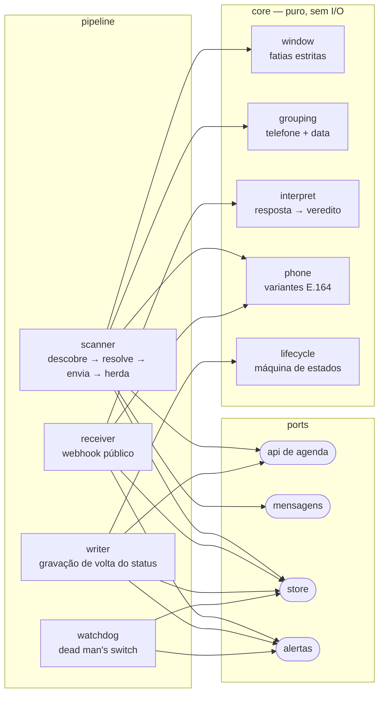

# lembretes-consulta-whatsapp

**Arquitetura de referência para lembretes de consulta 24 horas antes, entre o
sistema de agenda de uma clínica e o WhatsApp — e os catorze modos de falha de
produção que moldaram o desenho.**

Stack em que isto foi aprendido: [Belle](https://belleapp.com.br) como sistema de
agenda, [RD Station Conversas](https://www.rdstation.com/conversas/) como canal
oficial de WhatsApp, Node.js numa única instância pequena. A RD Station confirmou
por escrito que a integração era possível e que eles não a constroem — daí um
serviço.

Este repositório não é aquele deploy. É o raciocínio, mais uma implementação de
referência executável com adapters em memória. Sem dado de cliente, sem
credencial, sem os clientes reais das APIs. Ver [O que não está aqui](#o-que-não-está-aqui).

```
npm test    # 56 testes, sem etapa de instalação — não há dependências
npm run demo
```

---

## O problema

A agenda de uma clínica é cheia de consultas que ninguém confirma. A recepção
liga para as pessoas uma a uma; pacientes esquecem; horários ficam vazios e nunca
são revendidos.

O mecanismo é simples de enunciar e quase todo feito de casos de borda:

1. A cada hora, achar os agendamentos que acontecem daqui a cerca de 24 horas.
2. Mandar para cada paciente uma mensagem de WhatsApp com dois botões:
   **Confirmo** / **Não irei**.
3. Quando a paciente responde, gravar o resultado de volta no agendamento, para
   que a recepção encontre a agenda confirmada de manhã sem fazer nada.

É no passo 3 que está a engenharia. A API do provedor de mensagens não tem
webhook de resposta, a resposta não traz nenhuma referência à mensagem que ela
responde, a API de agenda devolve HTTP 200 quando recusa uma gravação, e os dois
sistemas discordam sobre como se escreve um número de telefone.

## Experimente

```console
$ npm run demo

[10/03/2026, 08:30] scan — a fatia principal alcança a Ana
  8 agendamento(s) descoberto(s) em 2026-03-10, 2026-03-11
  5 consulta(s) de telefone → 2 grupo(s)
  vencidos 1 · enviados 1 · cedo demais 1 · sem telefone 1 · inalcançáveis 0 · já tratados 0 · herdados 0

[10/03/2026, 09:00] recebida "Confirmo" (botão exato)
  → applied
  gravação de volta: 4 gravado(s) · 0 recusado(s) · 0 adiado(s)

[10/03/2026, 09:00] recebida "Confirmo" (a segunda entrega da mesma mensagem pelo provedor)
  → unchanged
...
────────────────────────────────────────────────────────────────────────
Mensagens realmente enviadas
────────────────────────────────────────────────────────────────────────
  3 mensagem(ns) para 9 agendamentos

  → 5565990001111  ["Ana","2026-03-11","09:00, 10:00, 10:30, 11:30"]
  → 5565990003333  ["Beatriz","2026-03-11","14:00, 14:30"]
  → 5565990004444  ["Carla","2026-03-11","08:00"]
```

O dia simulado inclui uma paciente com quatro procedimentos, três pessoas
dividindo o mesmo telefone, um paciente sem telefone no cadastro, uma marcação
feita tarde demais para a janela de 24h, uma resposta em linguagem natural em vez
do botão, uma resposta vinda do número no formato legado, e o provedor entregando
a mesma mensagem duas vezes. Todo instante é parâmetro, então o dia inteiro roda
em milissegundos e a saída é idêntica toda vez.

## Arquitetura

Seis unidades num único processo, e uma linha dura entre a lógica e o mundo lá
fora.



`core/` são funções puras sobre dados simples. `pipeline/` orquestra. `ports/`
declara o que um adapter precisa oferecer; `adapters/fake/` implementa esses ports
em memória, e é isso que torna este repositório ao mesmo tempo testável e
publicável — os clientes reais simplesmente não estão aqui. Passo a passo completo
em [docs/architecture.md](docs/architecture.md).

## As partes interessantes

- **[Erros de custo diferente merecem tolerâncias diferentes](docs/decisions/0003-asymmetric-tolerance-confirm-vs-cancel.md)**
  — confirmar errado custa um no-show, que já é o que acontece quando ninguém
  responde. Cancelar errado manda a paciente para um horário que não existe mais.
  Por isso uma confirmação pode valer para o grupo inteiro, e um cancelamento num
  aparelho compartilhado é recusado de cara.
- **[A chave de agrupamento é o aparelho, não a paciente](docs/decisions/0002-group-by-phone-not-by-patient.md)**
  — a correção óbvia para mensagens duplicadas ("uma mensagem por paciente por
  dia") cobre menos da metade dos casos reais. Mãe agenda os filhos, casais e
  famílias dividem o telefone. Quem responde é o aparelho.
- **[O watchdog vigia dado, não processo](docs/decisions/0005-dead-mans-switch-over-uptime-check.md)**
  — uma checagem de uptime responde "o processo está escutando", que é a coisa
  menos interessante que pode ser verdade sobre um serviço cujo trabalho é mandar
  mensagens.
- **[O payload do webhook é chave de busca, nunca verdade](docs/decisions/0006-webhook-payload-as-lookup-key-not-truth.md)**
  — o endpoint é público e os ids de agendamento são sequenciais. Confiar num id
  vindo do corpo deixaria qualquer um que descobrisse a URL cancelar consultas
  reais só contando.

## Modos de falha de produção

[**docs/failure-modes.md**](docs/failure-modes.md) — catorze entradas, cada uma
com sintoma, causa raiz, correção e o teste de regressão que a fixa. Três que valem
além deste domínio:

- **[3] Configuração gravada como estado.** A allowlist de um piloto foi
  registrada em cada linha de lembrete como status terminal. Desligar o piloto não
  trouxe ninguém de volta, e ~80% da agenda de um dia foi pulada em silêncio. Um
  fato sobre o deploy num dado momento tinha sido guardado como fato sobre a
  entidade.
- **[5] Um monitor que verificava execução em vez de efeito.** Ele perguntava "o
  scanner rodou?" e respondeu "ok" num dia em que nada foi enviado para uma agenda
  cheia.
- **[4] Um alerta derivado de uma consulta de estado.** Se a condição sobrevive ao
  alerta, o alerta dispara para sempre — um grupo recancelado virou doze mensagens
  idênticas durante a madrugada. A retentativa deve continuar; só a notificação
  precisa de memória.

## Notas de integração

[docs/integration-notes.md](docs/integration-notes.md) — comportamento
reproduzível das duas APIs, escrito como fatos e contornos. O que custa um dia para
todo mundo: **um template aprovado pela Meta ainda não está disponível pela API**;
ele primeiro precisa virar uma *mensagem* dentro da integração do provedor, e é
essa mensagem, não o template, que tem o identificador que o endpoint de envio
espera.

## Segurança e privacidade

[docs/security-and-privacy.md](docs/security-and-privacy.md) — a ameaça de
enumeração no endpoint público e a defesa em duas partes, e a retenção mínima:
payloads recebidos de números sem lembrete aguardando resposta são descartados
antes de qualquer gravação, então conversas que não têm nada a ver com isto nunca
são armazenadas.

A própria proteção de publicação do repositório é
[`scripts/sanitize.mjs`](scripts/sanitize.mjs), que roda no CI. Ela procura os
*formatos* de segredos, porque uma lista commitada dos termos literais que nunca
podem ser publicados acabaria publicando todos eles.

## O que não está aqui

Por desenho, não por omissão:

- **Sem clientes reais das APIs.** Os adapters de Belle e RD Station não estão
  neste repositório. `ports/` descreve o que eles precisam fazer; `adapters/fake/`
  fornece substitutos em memória.
- **Sem credenciais, hostnames, identificadores de template, nomes de banco ou
  nomes de processo.** Nem nome, cidade ou volume de negócio de cliente algum.
- **Sem persistência real.** O store é um `Map`. O schema relacional equivalente
  está em [docs/schema.sql](docs/schema.sql).
- **Sem agendador, servidor HTTP ou gerenciador de processos.** `scan`,
  `receiveWebhook`, `processWriteBacks` e `watchdog` são funções; ligá-las a um
  cron e a um router é trabalho de deploy e não tem nada de interessante.
- **Sem reconciliação dos placeholders "sem telefone" entre dias**, e **sem fluxo
  de remarcação** — remarcar ficou explicitamente fora do escopo, porque dois
  botões é o limite do provedor e uma mensagem digitada é trabalho de gente.

Este é um retrato do raciocínio em **agosto de 2026**. O deploy de onde ele veio
continua mudando; este repositório não o acompanha.

## Licença

MIT.
