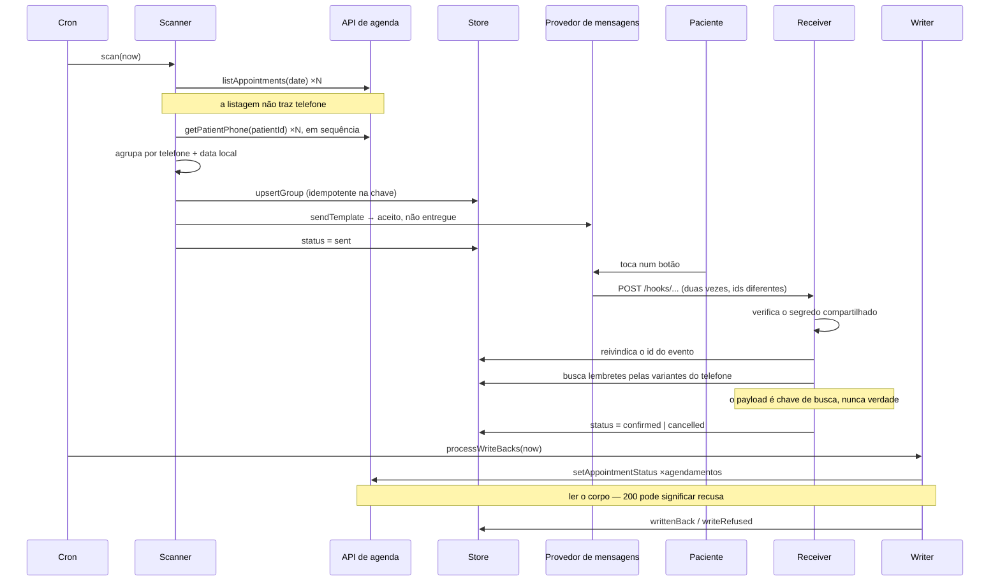

# Arquitetura

Um processo, seis unidades e uma fronteira rígida entre a lógica e o mundo externo.

## Por que um serviço dedicado

Havia três opções na mesa.

**A — um serviço Node dedicado (escolhida).** Processo próprio, schema de banco
próprio, deploy próprio. Custa um pouco de duplicação.

**B — incorporar à API interna existente.** Descartada por um acoplamento que já
tinha saído caro: derrubar aquela API, uma vez, derrubou junto uma página pública de
vitrine, em silêncio, respondendo HTTP 200 com a galeria vazia. Um serviço que grava
nos agendamentos de pacientes não pode ter como derrubar outra coisa, nem pode cair
por causa do deploy de outra coisa.

**C — uma plataforma de automação low-code.** Descartada por três motivos: custo
mensal recorrente dentro de um projeto de preço fechado, fraqueza exatamente onde mora
a dificuldade (idempotência, throttling, classificação de retry) e pressão de memória
numa instância de 2 GB que já rodava três serviços e um banco de dados.

Registrado na [ADR 0001](decisions/0001-dedicated-service-over-low-code.md).

## As seis unidades

| Unidade | Responsabilidade |
|---|---|
| `scanner` | De hora em hora, em quatro fases: descobrir, resolver telefones, enviar, herdar |
| `store` | Estado dos lembretes, idempotência, memória de alertas, log de eventos |
| `sender` | Envia o template (dentro da terceira fase do scanner) |
| `receiver` | O único caminho público: o webhook de resposta do provedor |
| `writer` | Grava o resultado de volta no agendamento |
| `watchdog` | Dead man's switch sobre o dado: o trabalho aconteceu de fato? |

Elas vivem num só processo porque compartilham um banco e um deploy, e porque as
fronteiras que importam aqui são os *ports*, não as fronteiras de processo.

## Camadas

```
src/
  core/       funções puras sobre dados simples — sem I/O, sem relógio, sem rede
  ports/      o que um adapter precisa fornecer: lista de métodos mais a justificativa
  adapters/   fake/ vem no repositório; os clientes reais vivem no deploy, não aqui
  pipeline/   orquestração: scanner, receiver, writer, watchdog
  config.js   tudo o que é configuração, e não port
  index.js    montagem, com os contratos dos ports verificados na construção
```

`core/` é onde moram as decisões interessantes, e é inteiramente testável com valores
simples:

- `window.js` — fatias estritas de antecedência, e a distinção entre *cedo demais* e
  *inalcançável*
- `grouping.js` — juntar agendamentos em um lembrete por aparelho por dia
- `interpret.js` — do texto da resposta ao veredicto, com tolerância assimétrica
- `phone.js` — identidade de telefone entre dois sistemas que discordam
- `lifecycle.js` — a máquina de estados, incluindo a regra de que nenhum estado pode
  descrever configuração

## Fluxo de dados



## As quatro fases do scanner

Separadas porque falham de jeitos diferentes. Falhar na descoberta é indisponibilidade;
falhar na busca de um telefone custa uma paciente; falhar num envio custa uma
mensagem. Juntar tudo numa passada só faz toda falha parecer a pior delas.

1. **Descobrir** — listar os agendamentos de toda data local que alguma fatia alcança.
   As datas são *derivadas das definições de fatia*, não fixadas em "amanhã": uma
   fatia de recuperação de 12 horas alcança o dia de hoje, e fixar D+1 é exatamente
   como uma segunda fatia deixa de encontrar metade dos candidatos sem ninguém
   perceber.
2. **Resolver telefones** — uma busca por *paciente*, não por agendamento, em
   sequência, dentro do rate limit da API.
3. **Enviar** — agrupar, checar a fatia, fazer o upsert (é aí que mora a
   idempotência), ler a configuração, enviar uma vez por grupo.
4. **Herdar** — um agendamento marcado depois que o grupo já respondeu simplesmente
   entra na linha existente. Como a fila de write-back seleciona por "ids de
   agendamento ainda não gravados", a herança não precisa de caso especial: ela sai
   naturalmente do modelo de dados.

## Por que isto é publicável

Os adapters reais não estão neste repositório, e nada acima deles sabe a diferença.
Em produção, `belle-client` e `rd-client` ficavam atrás de interfaces finas para que o
pipeline pudesse ser testado sem rede — e essa mesma costura é o que torna o código
publicável. **Testabilidade e publicabilidade acabam sendo a mesma propriedade vista
de dois ângulos.**

Os fakes são deliberadamente pouco prestativos onde a realidade é pouco prestativa: a
listagem omite os telefones, uma gravação pode ser recusada com o transporte dando
sucesso, e não existe forma de reportar uma mensagem como entregue. Um fake mais
gentil faria os testes passarem e o código de produção ficar errado.

## Tempo

`now` é parâmetro de todo ponto de entrada, e não algo lido de um relógio. É isso que
permite que um dia simulado inteiro — vários scans, respostas chegando entre eles,
gravações de volta e o watchdog — rode como um único teste determinístico, em
milissegundos.

## O que um deploy acrescenta

Fora deste repositório, e nada disso é interessante: um agendamento no cron, um
roteador HTTP expondo exatamente um caminho público, um gerenciador de processos, um
banco de dados real por trás do [`schema.sql`](schema.sql) e dois clientes de API
implementando [`ports/scheduling-api.js`](../src/ports/scheduling-api.js) e
[`ports/messaging.js`](../src/ports/messaging.js).

Uma nota de deploy que vale guardar, porque é decisão e não encanamento: o serviço
escuta só em loopback, e apenas o caminho do webhook é exposto pelo proxy reverso.
Escutar em todas as interfaces e contar com o firewall como barreira única é um padrão
razoável para muitos serviços, e um padrão ruim para algo que grava nos agendamentos
de pacientes.
